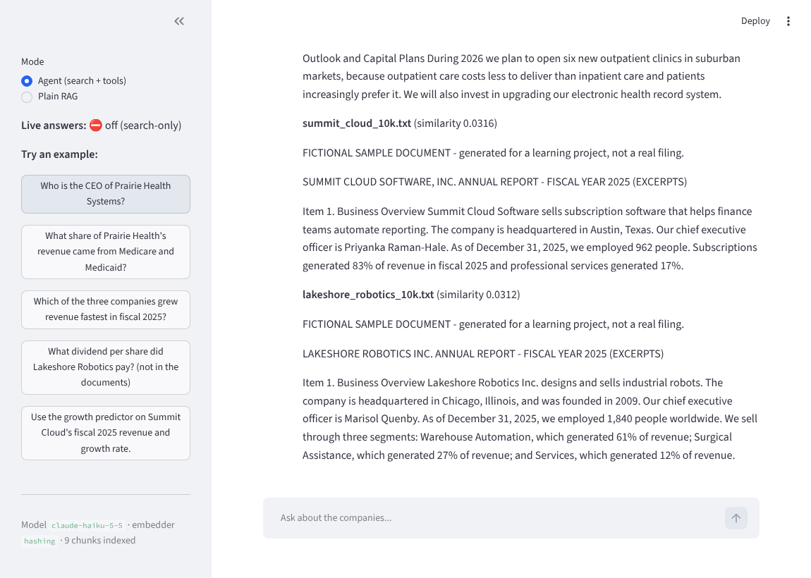

# rag-agent-eval

A question-answering system over company annual reports that **answers from the documents, cites its sources, can call a prediction model as a tool, and measures its own accuracy**.

- **RAG**: retrieve relevant passages (ChromaDB + embeddings), then have Claude answer using only those passages.
- **Agent**: Claude decides when to search and when to call a scikit-learn growth model, over several steps if needed.
- **Eval**: retrieval metrics (hit@k, MRR), answer accuracy, abstention on unanswerable questions, an LLM faithfulness judge, and tool-choice accuracy.

> The bundled data is **fictional** (3 invented companies) so everything runs out of the box. Swap in real filings to make it yours (see below).

## Try it (for reviewers)



| Fastest | How |
|---|---|
| **Hosted demo** | `<paste your live link here>`: search works instantly; live Claude answers need an access code (ask me) |
| **One command (Docker)** | `cp .env.example .env && docker compose up --build`, then open http://localhost:8501 |
| **One command (no Docker)** | `./run.sh` (Mac/Linux) or `run.bat` (Windows) |
| **Just read the evidence** | evaluation results: [`eval_results/latest_summary.md`](eval_results/latest_summary.md); tests: `python -m pytest` |

Deployment details and cost safeguards: [DEPLOY.md](DEPLOY.md).

## Architecture

```
 data/*.pdf|txt|md
        │  ingest.py        read + split into overlapping chunks
        ▼
   chunks ──embeddings.py──▶ vectors ──vectorstore.py──▶ ChromaDB (chroma_db/)
                                                              │ top-k similar chunks
 question ───────────────────────────────────────────────────┤
        │                                                     ▼
        ├─ rag.py    retrieve once ─▶ Claude answers ONLY from context, cites sources
        └─ agent.py  Claude loop: search_documents ⇄ predict_growth ─▶ final answer
                                         │
                                  predictor.py (scikit-learn LinearRegression)

 eval.py / compare_configs.py  score all of the above against eval_set.json
 app.py                        Streamlit chat UI
```

## Quick start

```bash
python3 -m venv venv && source venv/bin/activate      # Windows: venv\Scripts\activate
pip install -r requirements.txt

cp .env.example .env          # then paste your ANTHROPIC_API_KEY into .env
python generate_sample_data.py   # creates data/ and eval_set.json (skip if you bring your own)
python build_index.py            # chunk + embed + store (first run downloads the ~90MB MiniLM model)

python rag.py "Who is the CEO of Prairie Health Systems?"
python agent.py "Use the growth predictor on Summit Cloud's fiscal 2025 results."
streamlit run app.py
```

No API key yet? Everything that doesn't call Claude works offline:

```bash
EMBEDDER=hashing python build_index.py --force
EMBEDDER=hashing python eval.py --mode retrieval
EMBEDDER=hashing python compare_configs.py --embedders hashing
python -m pytest
```

## Run the interface on your computer

The UI is a Streamlit chat app (`app.py`). After the quick start above:

```bash
streamlit run app.py        # opens http://localhost:8501 in your browser
```

- **Sidebar:** switch between *Agent (search + tools)* and *Plain RAG*, see the model, embedder and chunk count.
- **Chat box:** ask questions; answers show source files, an expandable "Agent steps" panel (which tools were called, with inputs/outputs) and "Retrieved passages".
- **No API key yet?** The app starts in *search-only mode* and shows the passages retrieval finds, so you can try it before setting up billing.
- **Stop it:** press `Ctrl+C` in the terminal. **Different port:** `streamlit run app.py --server.port 8600`.
- **Windows:** use `venv\Scripts\activate` and `copy .env.example .env`.

### Putting it online

See [DEPLOY.md](DEPLOY.md): free hosting on Streamlit Community Cloud or Hugging Face Spaces, Docker, and the access-code / daily-cap safeguards that keep strangers from spending your API credits.

## Evaluate it

```bash
python eval.py --mode retrieval   # free, offline-capable
python eval.py --mode rag         # needs API key (~40 calls with the judge)
python eval.py --mode agent       # needs API key
python eval.py --mode all
python compare_configs.py         # grid over embedder x chunk size x top-k
```

Output goes to `eval_results/latest_summary.md` (+ timestamped JSON with every answer, so you can read the failures, which is where the learning is).

## What was and wasn't verified

Checked when this was built (no API key or model downloads were available in that environment):
- 15 unit tests pass, including the full agent tool-use loop against a scripted fake client (tool call, tool result fed back, error handling, step limit).
- Chunking, ChromaDB indexing/retrieval, predictor training (held-out R² 0.90 on the synthetic data), and the retrieval eval all ran end to end using the offline `hashing` embedder.

- The Streamlit UI was launched in a real browser and driven through its search-only mode (no API key).

**Not** run yet, so expect to debug a little on your side:
- Live calls to Claude (`rag.py`, `agent.py`, `eval.py --mode rag|agent`, and answer mode in `app.py`).
- The MiniLM embedder (needs internet to download the model once).

If something fails, read the traceback top to bottom, since the code is small enough to debug line by line. That is part of the exercise.

## Use your own documents

1. Download 3 to 6 real filings (SEC EDGAR 10-Ks, or any PDFs you care about) into `data/`; delete the fictional `.txt` files.
2. `python build_index.py --force`
3. **Rewrite `eval_set.json`** with 20+ questions whose answers you verified by hand in the documents. Each factual question needs `gold_source` and a short `gold_evidence` string that appears verbatim in the source. `tests/test_pipeline.py::test_eval_set_is_consistent_with_documents` checks that for you.
4. Replace `data/financials.csv` with real company-year data if you want a meaningful predictor.

## Experiments to run (the "break it on purpose" step)

Record the numbers; they become your resume bullets and interview answers.

1. `python compare_configs.py` with real documents. Which chunk size wins, and why? What happens to hit@1 vs hit@4?
2. Switch `EMBEDDER=hashing` vs `minilm`. Which questions does keyword-only search miss that semantic search finds?
3. Set `TOP_K=1` then `TOP_K=8` and re-run `eval.py --mode rag`. What happens to accuracy, faithfulness, and latency?
4. Delete the "reply exactly: I don't have enough information" rule from the prompt in `rag.py`. How does accuracy on `unanswerable` questions change?
5. Compare `--mode rag` vs `--mode agent` on the same questions. Where does the agent help? Where does it just add latency and cost?

## Honest limitations (put these in your own write-up)

- **Small sample data**: with 9 chunks, almost any setup retrieves the right passage, and larger chunks look artificially good in `compare_configs.py` because a big chunk is more likely to contain the evidence string. Draw conclusions from real documents only.
- **Keyword accuracy is crude**: a correct answer phrased unexpectedly counts as wrong. Read the failures before trusting the score.
- **LLM judge**: the faithfulness judge is itself a model and can be wrong or biased toward its own family's style. Spot-check a sample by hand.
- **The predictor** is a linear regression trained on *synthetic* data. It demonstrates the tool-calling pattern, not real forecasting.
- **No re-ranking, hybrid search, or query rewriting**, which are natural next steps (see below).

## Ideas to extend it

BM25 + vector hybrid search, a cross-encoder re-ranker, query rewriting, the RAGAS library alongside the hand-built judge, citation checking (does each cited file actually support the claim?), caching, and a Dockerfile.

## Be ready to answer (interview prep)

- Why this chunk size and overlap? What does your comparison table show?
- What happens when retrieval returns nothing relevant? (Look at the `unanswerable` results.)
- How do you know it isn't hallucinating? What does your judge miss?
- Why a vector DB and a local embedding model? What would you change at 1M documents?
- When is an agent better than plain RAG, and what does it cost?
- What is the weakest part of this project?

## Resume bullets (fill in YOUR measured numbers; don't keep the placeholders)

```
RAG Agent with Evaluation Pipeline | github.com/<you>/rag-agent-eval
Python, Claude API, ChromaDB, sentence-transformers, scikit-learn, Streamlit
• Built a retrieval-augmented agent over <N> real <domain> documents that answers with source
  citations and abstains when the documents lack the answer
• Added a scikit-learn model as an agent tool; the agent chooses between retrieval and prediction
  (tool-choice accuracy <X>% on <N> test questions)
• Designed a <N>-question evaluation suite measuring retrieval hit@k/MRR, answer accuracy and
  LLM-judged faithfulness; tuned chunk size from <A> to <B>, improving hit@4 from <X> to <Y>
```

## Files

| File | Purpose |
|---|---|
| `config.py` | all settings, overridable via `.env` |
| `ingest.py` | load files, split into overlapping chunks |
| `embeddings.py` | MiniLM (semantic) and hashing (offline) embedders |
| `vectorstore.py` | ChromaDB index + similarity search |
| `llm.py` | Claude API wrapper |
| `rag.py` | retrieve-then-answer pipeline |
| `agent.py` | tool-use loop (search + predictor) |
| `predictor.py` | trains/serves the growth model |
| `eval.py` | retrieval, RAG and agent evaluation |
| `compare_configs.py` | config grid search on retrieval quality |
| `app.py` | Streamlit UI (example questions, access gate, evaluation panel) |
| `access.py` | access code + daily query budget for public demos |
| `generate_sample_data.py` | builds the fictional dataset + eval set |
| `tests/` | unit tests (run offline) |
| `Dockerfile`, `docker-compose.yml` | containerized run |
| `run.sh`, `run.bat` | one-command local setup + launch |
| `.github/workflows/tests.yml` | CI: runs the tests on every push |
| `.streamlit/` | Streamlit config + secrets template |
| `DEPLOY.md` | hosting guide |
